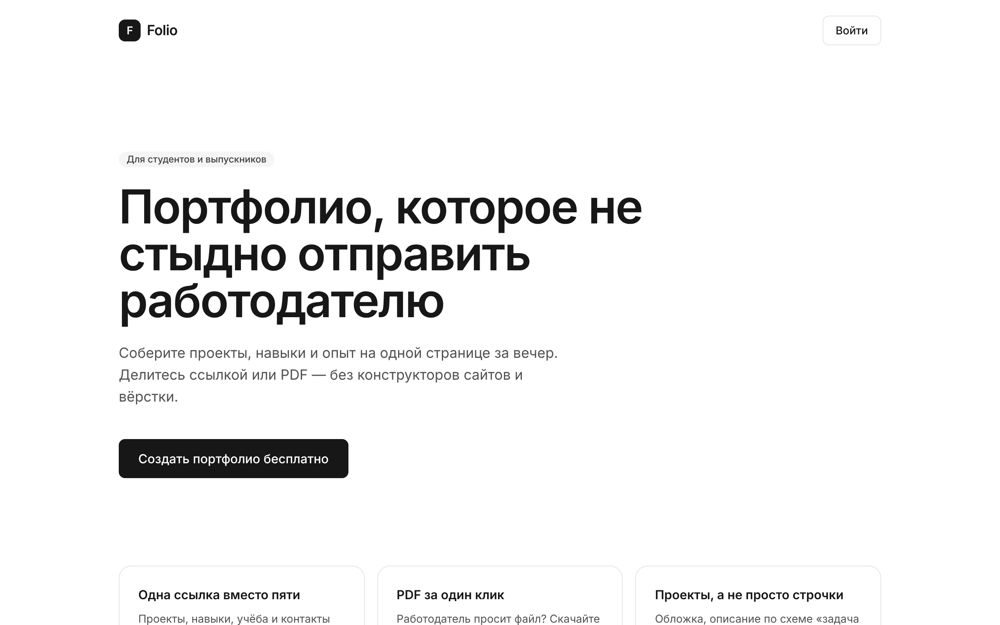

# Folio

[Русский](README.md) · [English](README.en.md)

[](https://folio-mu-jet.vercel.app)
[](LICENSE)


A portfolio builder for students: collect your projects, skills and experience on one page and send it to an employer as a single link or a PDF.



[](https://vercel.com/new/clone?repository-url=https%3A%2F%2Fgithub.com%2Feeeeeeeert3103-create%2Ffolio&env=NEXT_PUBLIC_SUPABASE_URL,NEXT_PUBLIC_SUPABASE_PUBLISHABLE_KEY&envDescription=Supabase%20Project%20Settings%20%E2%86%92%20API%20Keys)

Before deploying, create a Supabase project and apply the migrations (steps 2–4 below).

**Stack:** Next.js 16 · React 19 · Tailwind CSS 4 · Zod · Supabase (database, email sign-in, image storage)

> The UI is currently in Russian.

## Features

- Landing page
- Passwordless sign-in with a magic link
- Dashboard: profile, avatar, skills, links, projects with cover images, project ordering
- Public page at `/username` to share with employers
- "PDF" button: a clean print version you can save as PDF
- Profiles are private by default; publishing is an explicit dashboard choice

## Run locally

1. Install [Node.js](https://nodejs.org) (LTS).
2. Create a free project at [supabase.com](https://supabase.com).
3. In Supabase open **SQL Editor**, paste the files from `supabase/migrations/` and press **Run**.
4. In Supabase: **Authentication → URL Configuration** → add `http://localhost:3000/**` to *Redirect URLs*.
5. Copy `.env.example` to `.env.local` and fill in the URL and Publishable key from **Project Settings → API Keys**.
6. In the project folder:

   ```bash
   npm install
   npm run dev
   ```

7. Open http://localhost:3000

## Deploy

```bash
npx vercel deploy --prod
```

## Security

- Session in `httpOnly` cookies; the browser never talks to Supabase directly, everything goes through the server.
- Per-request nonce Content-Security-Policy, no `unsafe-inline` scripts.
- All access rules are enforced by the database (RLS): other users' data can't be read or changed even when bypassing the site.
- Images live in a private bucket and are served via short-lived signed URLs, only when shown on a public page.
- Input is validated with Zod on the server and by database constraints; per-user rate limits.

## License

[MIT](LICENSE)
